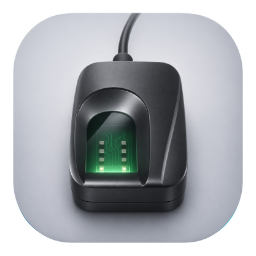
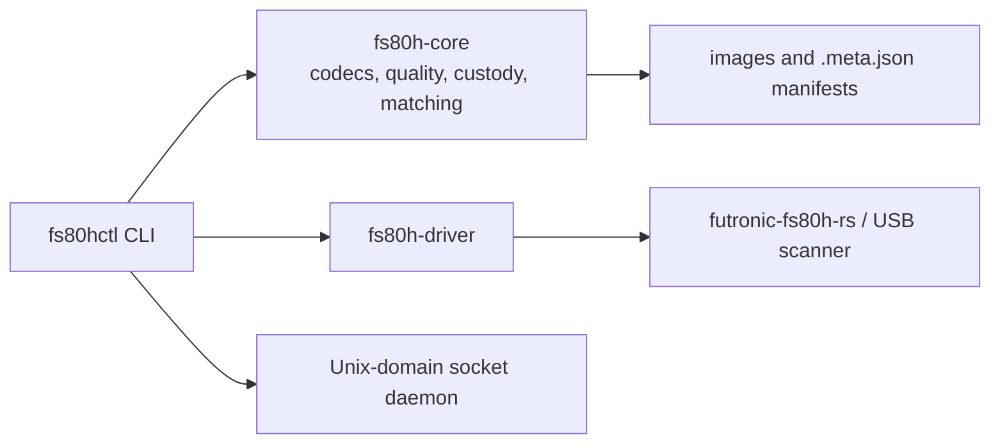

<p align="center">
  
</p>

<h1 align="center">fs80hctl</h1>

<p align="center">
  Technical control and image-processing CLI for Futronic optical fingerprint scanners.
</p>

<p align="center">
  Capture 500 DPI optical frames, preserve their technical custody metadata, inspect and convert biometric images, and run deterministic 1:1 or 1:N comparisons.
</p>

<p align="center">
  <a href="https://github.com/faeliaso/fs80hctl/actions/workflows/release.yml"></a>
  <a href="https://github.com/faeliaso/fs80hctl/actions/workflows/ci.yml"></a>
  <a href="LICENSE"></a>
  <a href="https://www.rust-lang.org/"></a>
  <a href="https://github.com/faeliaso/fs80hctl/releases"></a>
</p>

<p align="center">
  <a href="#features">Features</a> ·
  <a href="#installation">Installation</a> ·
  <a href="#quick-start">Quick Start</a> ·
  <a href="#usage">Usage</a> ·
  <a href="#architecture">Architecture</a> ·
  <a href="#development">Development</a> ·
  <a href="#documentation">Documentation</a>
</p>

---

## What is fs80hctl?

`fs80hctl` is a Rust command-line tool for technical control of Futronic FS80, FS80H, and FS81H optical fingerprint scanners. It is intended for operators and developers who need local acquisition, image conversion, diagnostics, technical quality analysis, or deterministic biometric-image comparison.

It captures 320×480, 8-bit grayscale frames at 500 DPI and records a SHA-256 hash of the raw sensor buffer in an adjacent custody manifest. The CLI also works with supported image files without a connected scanner.

> [!WARNING]
> The comparison and liveness outputs are technical engineering indicators. They are not civil identification, expert forensic reports, or certified presentation-attack-detection (PAD) results. Do not use this tool as the only authentication factor for critical physical or financial access.

## Why fs80hctl?

### The problem

Using a scanner in a technical workflow often requires separate tools for USB diagnostics, capture, format conversion, image inspection, and custody tracking. Those steps can make automation and repeatability harder.

### The approach

`fs80hctl` provides these operations through one local CLI. Its hardware-independent image and matching logic remains separate from the USB driver, and all automated tests use synthetic fixtures rather than real biometric data.

## Features

### Acquisition and device control

- **USB discovery and inspection** — lists supported Futronic devices and can open a selected bus and address.
- **Optical capture** — saves immediate frames or waits for finger presence with timeout and quality gating.
- **Best-of-N enrollment** — captures several samples and selects the highest-quality frame.
- **Capture daemon** — keeps a Unix-domain socket service available for low-latency capture requests.
- **Environment diagnostics** — checks the USB subsystem, device permissions, udev rules, groups, filesystem access, and NFIQ 2 availability.

### Images, integrity, and analysis

- **Supported formats** — PNG, TIFF, PGM, RAW/DAT, WSQ, JPEG 2000/JP2, JPEG, and BMP.
- **Forensic transcoding** — converts between supported formats while preserving the custody lineage in `.meta.json` manifests.
- **Technical inspection** — reports dimensions, DPI, the SHA-256 buffer hash, image quality metrics, and custody history.
- **Local quality metrics** — evaluates mean local variance and sensor saturation.
- **Image tools** — provide Gabor enhancement, format interchange, and deterministic synthetic benchmarks.

### Comparison and forensic utilities

- **Verification** — performs deterministic 1:1 comparison or 1:N gallery search.
- **Forensic commands** — annotate minutiae, compare corroborated pairs, emit JSON reports, and run a static liveness heuristic for authorized technical evaluation.
- **Minutiae templates** — create, inspect, validate, convert, and explicitly Base64-transport ISO/IEC 19794-2 and ANSI INCITS 378 template profiles.
- **Structured output** — commands that produce structured results support the global `--json` option.

## Use cases

- Verify scanner connectivity and user permissions before an acquisition session.
- Capture an optical frame as a 500 DPI TIFF or PNG with an integrity manifest.
- Convert a capture to PGM for an external NIST NBIS workflow.
- Inspect an image and its custody metadata before sending it to an authorized technical process.
- Compare a probe image against a reference file or an enrolled-image directory.

## Requirements

### To use the CLI

- macOS or Linux.
- A Futronic FS80, FS80H, or FS81H connected by USB for device operations and capture.
- On Linux, access to the Futronic USB device. The release installer configures the included udev rules.

No proprietary Futronic SDK or dynamic image libraries are required. The project uses the pure-Rust [`futronic-fs80h-rs`](https://crates.io/crates/futronic-fs80h-rs) driver.

### To develop or build from source

- Rust and Cargo compatible with the Rust 2024 edition.
- For physical scanner testing, `libusb-1.0` and `pkg-config`; see [TESTING.md](TESTING.md).

## Installation

### macOS with Homebrew

```sh
brew install faeliaso/tap/fs80hctl
```

### Linux release installer

The installer supports `x86_64` and `aarch64`. It downloads the latest GitHub release, verifies its checksum, installs the binary, and configures the Futronic udev rules. It requires `curl`, `tar`, `sha256sum`, `udevadm`, and administrator privileges.

```sh
curl -fLO https://raw.githubusercontent.com/faeliaso/fs80hctl/main/scripts/install.sh
sudo bash install.sh
```

### Build from source

```sh
git clone https://github.com/faeliaso/fs80hctl.git
cd fs80hctl
cargo build --release --workspace
./target/release/fs80hctl --version
```

## Quick Start

After installation, check the environment and discover connected scanners:

```sh
fs80hctl doctor
fs80hctl devices
```

Capture a PNG image and inspect it:

```sh
fs80hctl capture --output capture.png
fs80hctl inspect capture.png
```

The capture creates both the image and an adjacent manifest:

```text
capture.png
capture.png.meta.json
```

Use `cargo run -p fs80h-cli -- <command>` in place of `fs80hctl <command>` when running from a source checkout without installing the binary.

## Usage

### Common commands

| Command | Description |
| --- | --- |
| `fs80hctl doctor` | Diagnose the local USB, permissions, udev, and filesystem setup. |
| `fs80hctl devices` | List supported scanners connected through USB. |
| `fs80hctl device inspect` | Open and inspect the first available scanner. |
| `fs80hctl capture --output capture.png` | Capture an optical frame. |
| `fs80hctl enroll --output master.png` | Acquire the default three samples and save the highest-quality image. |
| `fs80hctl convert input.png --to tiff --output output.tiff` | Convert an image while preserving custody lineage. |
| `fs80hctl inspect input.tiff` | Report image and manifest information. |
| `fs80hctl verify probe.png reference.png --threshold 40` | Run a 1:1 technical comparison. |
| `fs80hctl template create capture.png --template-format iso2011 --output finger.fmr` | Extract operational minutiae and create a template. |
| `fs80hctl serve` | Start the Unix-domain socket capture daemon. |

### Capture and enrollment

```sh
# Wait for a stable finger contact for up to 15 seconds.
fs80hctl capture --wait --timeout 15 --min-quality 60 --output capture.png

# Capture directly as a 500 DPI TIFF.
fs80hctl capture --image-format tiff --output forensic.tiff

# Select the best frame from five samples.
fs80hctl enroll --samples 5 --timeout 20 --min-quality 65 --output master.png
```

### Low-latency capture daemon

Keep the scanner open in one local process and request captures through a Unix-domain socket. Use a private directory when more than one local account can access the machine:

```sh
# Terminal 1: start the daemon.
mkdir -p "$HOME/.local/run"
chmod 700 "$HOME/.local/run"
fs80hctl serve --socket-path "$HOME/.local/run/fs80h.sock"

# Terminal 2: request a capture through the daemon.
fs80hctl capture --client --socket "$HOME/.local/run/fs80h.sock" \
  --timeout 15 --min-quality 60 --output capture.png
```

The daemon accepts one capture at a time, streams local JSON events internally, and does not persist biometric data itself. The client command writes the image and its custody manifest. Stop the daemon with `Ctrl+C`.

### Conversion and comparison

```sh
# Convert to Netpbm PGM for compatible external tooling.
fs80hctl convert capture.png --to pgm --output capture.pgm

# Search a directory of enrolled images.
fs80hctl verify probe.png --gallery ./enrolled-users --threshold 40

# Emit structured output for an automation pipeline.
fs80hctl --json inspect capture.png
```

`forensic compare` requires at least six geometrically consistent minutiae pairs before it can report a non-zero score. The static liveness heuristic exits with code `4` below its threshold and is not validated to ISO/IEC 30107-3 or LivDet.

### Minutiae templates

Create a template from a captured image, validate its binary structure, and use explicit Base64 only when a text transport is required:

```sh
fs80hctl template create capture.png --template-format iso2011 \
  --finger right-index --impression live-plain --output right-index.fmr
fs80hctl template validate right-index.fmr --template-format iso2011
fs80hctl template base64 encode right-index.fmr --template-format iso2011 > right-index.b64
fs80hctl template base64 decode right-index.b64 --template-format iso2011 --output restored.fmr
cmp right-index.fmr restored.fmr
```

Profiles: `iso2005`, `iso2011`, `ansi2004`, `ansi2009`, and `ansi2009-am1`. Template generation and validation are operational/structural features; they do not certify AFIS matching accuracy, PAD/liveness, or external-profile conformance.

For every command and flag, run `fs80hctl --help` or read the [technical manual](docs/MANUAL.md).

## Architecture

The repository is a Rust workspace with three crates. `fs80h-core` has no USB or native hardware dependency; the CLI composes the core logic and the USB driver.



| Layer | Technology | Responsibility |
| --- | --- | --- |
| CLI | Rust, Clap, Tokio | Command parsing, JSON output, orchestration, and daemon service. |
| Core | Rust | Image codecs, quality metrics, SHA-256 custody manifests, minutiae analysis, and comparison. |
| Driver | `futronic-fs80h-rs`, `rusb` | Futronic USB-device discovery and transport. |
| Operations | udev, systemd | Linux device permissions and optional socket activation. |

## Project Structure

```text
crates/
  fs80h-cli/       command-line interface and capture daemon
  fs80h-core/      hardware-independent image and biometric logic
  fs80h-driver/    Futronic USB-driver integration
docs/              technical, validation, NFIQ 2, and fuzzing guides
tests/             hardware-free tests and approved synthetic fixtures
scripts/           installation, validation, and physical-test scripts
udev/              Linux USB permission rules
systemd/           optional Linux capture-daemon units
man/               fs80hctl man page
```

## Security and Biometric Data

- Capture only with the operator's explicit command and appropriate authorization.
- Keep real biometric images and generated manifests out of the repository.
- Store sensitive captures only in restricted locations and dispose of them after their technical purpose is complete.
- Report vulnerabilities privately; do not disclose potential data leaks in public issues.

See [SECURITY.md](SECURITY.md) for the operational boundaries, biometric-data lifecycle, and responsible disclosure policy.

## Development

| Command | Description |
| --- | --- |
| `cargo check --workspace` | Type-check the workspace. |
| `cargo test --workspace --verbose` | Run the hardware-free synthetic test suite. |
| `cargo fmt --all -- --check` | Verify Rust formatting. |
| `cargo clippy --workspace --all-targets -- -D warnings` | Run Clippy with warnings treated as errors. |
| `cargo doc --workspace --no-deps` | Build API documentation. |
| `cargo build --release --workspace` | Build release binaries. |
| `./scripts/check-clean-workspace.sh` | Check for biometric-data leaks in the workspace. |

All automated tests use deterministic synthetic fixtures and do not require a scanner. Physical testing is separate and requires authorization:

```sh
./scripts/test-physical.sh
```

Read [TESTING.md](TESTING.md) before running physical tests. The script writes captures to a temporary directory and those artifacts must be protected and safely deleted.

## Documentation

| Document | Contents |
| --- | --- |
| [docs/MANUAL.md](docs/MANUAL.md) | Command reference, options, formats, manifests, and exit codes. |
| [docs/BIOMETRIC_ENGINE.md](docs/BIOMETRIC_ENGINE.md) | Pure-Rust biometric engine architecture, Gabor enhancement, 360° alignment, and ZeroFMR gates. |
| [TESTING.md](TESTING.md) | Hardware-free tests, physical scanner testing, and authorized dataset validation. |
| [docs/NFIQ2_INTEGRATION.md](docs/NFIQ2_INTEGRATION.md) | Integration guide for NIST NFIQ 2. |
| [docs/FORENSIC_BIOMETRIC_VALIDATION.md](docs/FORENSIC_BIOMETRIC_VALIDATION.md) | Procedure for authorized biometric validation. |
| [docs/FUZZING.md](docs/FUZZING.md) | Fuzz-testing setup and commands. |
| [THIRD_PARTY_NOTICES.md](THIRD_PARTY_NOTICES.md) | Third-party component and license notices. |
| [CONTRIBUTING.md](CONTRIBUTING.md) | Contribution rules and engineering standards. |
| [SECURITY.md](SECURITY.md) | Security, privacy, and vulnerability-reporting policy. |

## Contributing

Contributions are welcome. Keep changes focused, add deterministic tests for new behavior, and run the relevant checks before opening a pull request. Never commit real biometric data, custody manifests, or captures.

See [CONTRIBUTING.md](CONTRIBUTING.md) for the complete contribution process and workspace rules.

## Support

For questions, bug reports, or feature requests, open an [issue](https://github.com/faeliaso/fs80hctl/issues). For a vulnerability or suspected biometric-data exposure, follow the private reporting process in [SECURITY.md](SECURITY.md).

## License

Licensed under the [MIT License](LICENSE).

Distributed artifacts also include [third-party notices](THIRD_PARTY_NOTICES.md). See the libusb note there before redistributing an artifact that statically links the vendored USB library.
